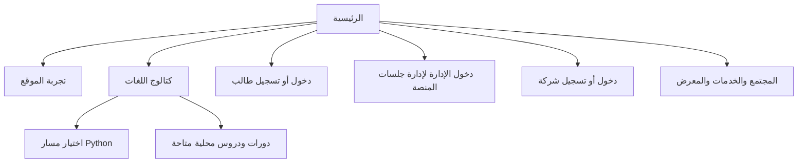
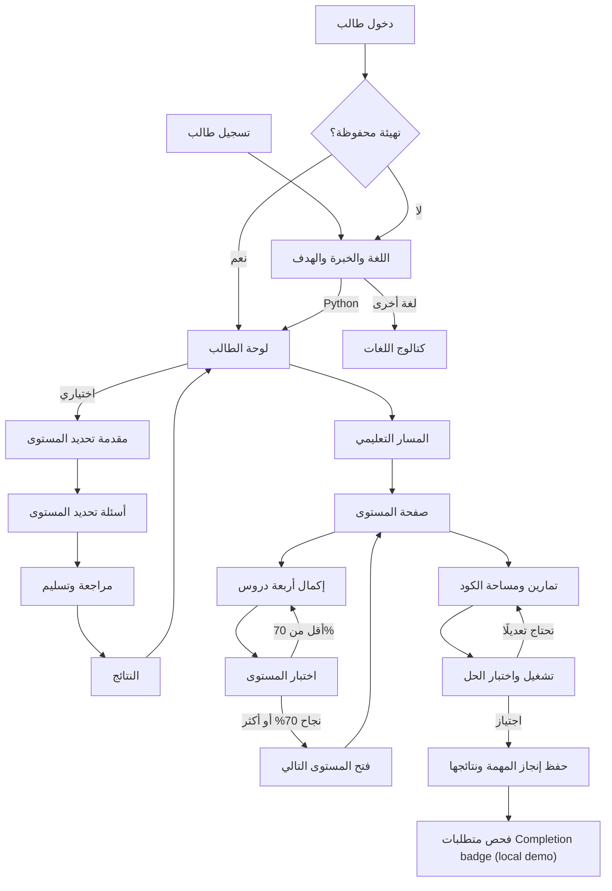
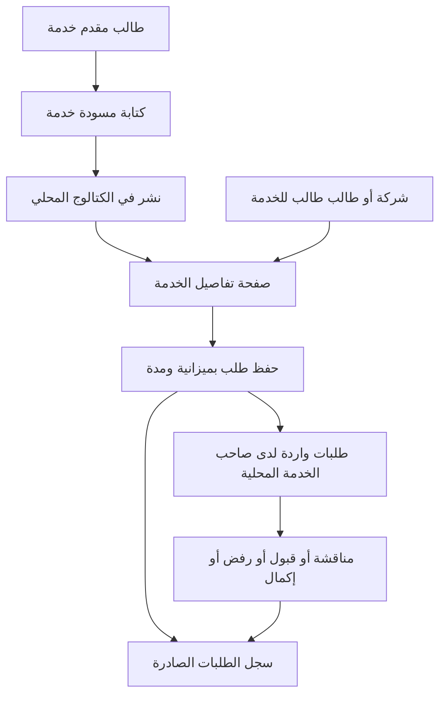

# خريطة المستخدمين والصفحات وسير العمل

هذه الخريطة تصف النسخة المحلية الحالية. الأعداد المستخرجة من ملفات المنهج في [الحالة الحالية](CURRENT-IMPLEMENTATION.md). تحتوي خريطة المسارات على 79 مدخلًا، بما فيها روابط المعلم القديمة المحوّلة.

## كيف تقرأ الخريطة؟

- **ربط محلي فعلي:** الصفحة التالية تقرأ بيانات حُفظت في الخطوة السابقة داخل نطاق التخزين نفسه.
- **رابط تنقّل:** يمكن فتح الصفحة، لكن هذا لا يعني نقل طلب أو إنشاء سجل لدى مستخدم آخر.
- **منفصل حاليًا:** توجد واجهتان للعملية نفسها من وجهتي نظر مختلفتين، دون ربط سجلاتهما.
- **مقترح للمستقبل:** ما يلزم لإكمال منصة متعددة المستخدمين؛ ليس وصفًا لوظيفة موجودة.

الأدوار الحالية هي الطالب والشركة والإدارة. تدريس الطالب يظل ضمن حسابه الطلابي بعد موافقة الإدارة؛ لا توجد بوابة دخول مستقلة للمعلم.

## 1. الزائر: الاستكشاف واختيار نقطة الدخول

| الصفحة | لماذا يحتاجها؟ | ما بعدها؟ |
|---|---|---|
| `index.html` | فهم فكرة المنصة واختيار نوع الاستخدام | تجربة، كتالوج، حساب أو خدمات |
| `pages/public/demo.html` | التعرف على تجربة المنتج | بدء رحلة الطالب أو الرجوع للرئيسية |
| `pages/public/languages.html` | البحث عن لغة ومعرفة المحتوى المتاح | مسار Python أو دورة محلية |
| `pages/public/course.html?id=…` | عرض مستويات ودروس دورة محددة | `lesson.html?course=…&level=…&lesson=…` |

**الحد الحالي:** المساران القابلان للتنفيذ هما Python (6 مستويات، 24 درسًا، 12 مهمة) وJavaScript (3 مستويات، 12 درسًا، 6 مهام). بقية اللغات Coming soon، وقد تحتوي معاينات أضافتها الإدارة. يوضح محدد My language الحالة ويحفظ اختيار كل طالب؛ تبقى بيانات كل لغة مستقلة. يوجد بنك Python من 10 أسئلة وبنك JavaScript من 12 سؤالًا. [قواعد تحديد المستوى](PLACEMENT-RULES.md) تتطلب 75% لكل موضوع وتسمح بتجاوز مستويين بحد أقصى، دون منح إنجاز أو تقدم للشهادة.

## 2. الطالب: الرحلة الأساسية

**المسار المقترح للعرض:** التسجيل ← التهيئة ← لوحة الطالب (تحديد المستوى اختياري) ← المسار ← المستوى ← الدروس ← اختبار المستوى ← المستوى التالي ← المشروع ← نتائج اختبارات الكود ← الشهادة.

### أ. الحساب والتهيئة — الصفحات المشتركة مع الحساب

| الصفحة | وظيفتها | الربط |
|---|---|---|
| `pages/auth/signup.html` | تسجيل حساب طالب محلي ببيانات تحقق مشتقة لكلمة المرور | `onboarding.html` |
| `pages/auth/login.html` | الدخول ببيانات عينة الطالب أو الحساب المسجل في المتصفح نفسه | لوحة الطالب عند وجود تهيئة، وإلا التهيئة |
| `pages/auth/forgot-password.html` | إعداد محاكاة استعادة كلمة المرور | رابط محلي إلى صفحة الاستعادة |
| `pages/auth/reset-password.html?demo=…` | إكمال محاكاة الاستعادة | لا يغير كلمة مرور حقيقية ولا بيانات العينة |
| `pages/auth/change-password.html` | عرض تجربة تغيير كلمة المرور | جزء من إعدادات الحساب التجريبية |
| `pages/student/onboarding.html` | اختيار اللغة والخبرة والهدف بالقيمة نفسها المستخدمة في My language | لوحة الطالب للغات الجاهزة؛ صفحة توافر واضحة وعلامة اهتمام محلية للغات غير الجاهزة |

**انتبه عند التجربة:** يستطيع الطالب المسجل العودة بكلمة مروره في المتصفح نفسه. يدعم حساب الشركة أيضًا كلمة مرور محلية. لا توجد مصادقة خادم أو مزامنة للحسابات بين الأجهزة، ولا حساب معلم مستقل.

### ب. التشخيص — 4 صفحات

| الصفحة | وظيفتها | الخطوة التالية |
|---|---|---|
| `pages/student/placement-intro.html` | شرح الاختبار وبدء أو استكمال المحاولة | الأسئلة، أو النتائج إن كانت المحاولة مسلمة |
| `pages/student/placement-question.html` | الإجابة والتنقل بين الأسئلة | المراجعة |
| `pages/student/placement-review.html` | مراجعة الأجوبة وتأكيد التسليم | النتائج |
| `pages/student/placement-results.html` | عرض التوصية وأسبابها حسب الموضوع، تطبيق البداية أو تأكيد البدء من 1 | المسار أو إعادة الاختبار |

**تحديد المستوى يختار البداية بعد تطبيق الطالب للتوصية، وليس بديلًا عن إنجاز المسار:** لا يعني الحصول على نتيجة جيدة فيه اجتياز الدروس أو مهام البرمجة أو استحقاق الشهادة تلقائيًا.

### ج. التعلم والتطبيق — 10 صفحات

| الصفحة | وظيفتها | متى أفتحها؟ |
|---|---|---|
| `pages/student/dashboard.html` | نقطة الرجوع: التقدم، متابعة التعلم، أعداد الطلبات والمسودات المحلية | بعد الدخول وبين الأنشطة |
| `pages/student/learning-path.html` | رؤية المستويات وحالتها والخطوة التالية | عند بدء التعلم أو اختيار المستوى |
| `pages/student/module.html?level=1` | دروس ومهام واختبار المستوى المختار | قبل العمل على محتوى المستوى |
| `pages/student/lesson.html?lesson=variables` | شرح ومثال ومصادر وسؤال فهم؛ الإجابة الصحيحة تسجل إكمال الدرس | لكل درس |
| `pages/student/level-assessment.html?level=1` | اختبار المستوى بعد إكمال دروسه | لنقل حالة المستوى إلى مكتمل عند النجاح |
| `pages/student/practice.html` | الوصول إلى مهام التطبيق | للتدريب العملي |
| `pages/student/workspace.html?task=student-profile` | كتابة Python وتشغيل الحل واختباره وحفظه | عند تنفيذ مهمة |
| `pages/student/code-review.html?task=student-profile` | عرض نتائج الاختبارات المحفوظة للمهمة | لمعرفة ما نجح وما يحتاج تعديلًا |
| `pages/student/project.html` | وصف مشروع Study Task Manager وحالة الاستعداد له | في المرحلة الأخيرة من Python |
| `pages/student/project-evaluation.html` | مدخل قديم محفوظ للتوافق | يحوّل إلى `code-review.html?task=task-manager` |

**قواعد الفتح الحالية:**

1. Python يحتوي **6 مستويات، 24 درسًا، 12 مهمة برمجة**، محسوبة من ملفات المنهج.
2. المستويات: الأساسيات؛ المنطق والتحكم؛ الدوال والمجموعات؛ البرامج الموثوقة والملفات؛ الكائنات والوحدات والاختبار؛ حل المشكلات بكفاءة.
3. إكمال دروس المستوى الأربعة يفتح اختباره.
4. إكمال دروس المستوى والنجاح في اختباره بنسبة **70% على الأقل** يفتح المستوى التالي.
5. مهام البرمجة تدريب إضافي بالنسبة لفتح المستويات. شهادة الأساسيات تتطلب مهام المستويات 1–3 الست، مع دروسها الـ12 والنجاح في اختباراتها الثلاثة؛ لا تتطلب مهام المستويات المتقدمة.
6. مشروع الأساسيات `task-manager` جزء من مهام الأساسيات الست، ومن مهام المسار الاثنتي عشرة؛ ليس مهمة إضافية.
7. صفحة المشروع تسمح بقراءة الوصف مبكرًا؛ الوصول العملي يرتبط بالتقدم إلى المرحلة المناسبة.
8. `code-review` يعرض نتائج اختبارات التنفيذ؛ ليس تقييمًا مفتوحًا من ذكاء اصطناعي.

JavaScript يتبع المخطط نفسه بثلاثة مستويات وأربعة دروس واختبار لكل مستوى، وست مهام إجمالًا. التنفيذ في Worker معزول بحد خمس ثوانٍ، ويستخدم `input()` أو `readLine()` للإدخال و`console.log()` للإخراج. التقدّم والمسودات وتحديد المستوى مفصولة بحسب الطالب واللغة؛ مفاتيح Python القديمة محفوظة. تغيير اللغة لا يحول إنجاز لغة إلى أخرى، وصفحات اللغة القديمة ترفض الحفظ بعد التبديل.

### د. المساعدة والنتائج والحساب — 7 صفحات

| الصفحة | وظيفتها | مصدر بياناتها أو صلتها |
|---|---|---|
| `pages/student/mentor.html` | مساعد تعليمي بشرح جاهز حسب السياق | الدرس أو المهمة؛ ليس نموذج AI متصلًا |
| `pages/student/skill-analysis.html` | فهم نتيجة التشخيص وتوزيع المهارات | محاولة تحديد المستوى المحفوظة |
| `pages/student/progress.html` | متابعة إنجاز التعلم | الدروس والمهام والاختبارات المحفوظة |
| `pages/student/learning-report.html` | تجميع تقرير تعلم قابل للطباعة | السجلات التعليمية المتاحة |
| `pages/student/certificates.html` | معاينة Completion badge (local demo) وطباعتها عند الاستحقاق؛ ليست شهادة قابلة للتحقق ولا تصدر من خادم | هوية طالب + 12 درسًا + نجاح الاختبارات الثلاثة + المهام الست |
| `pages/student/profile.html` | البيانات والتفضيلات المحلية؛ لا توجد أدوات استيراد أو تصدير نسخ التعلّم | هوية الطالب وتقدمه المحلي |
| `pages/student/subscription.html` | مقارنة Free وPremium وتغيير المعاينة المحلية | Free للمستويات 1–5؛ معاينة Premium المحلية للمستوى 6 المنشور |

**الاشتراك لا يختصر التعلم:** تفعيل Premium لا يجتاز اختبارًا ولا يفتح محتوى غير منشور. مستويات Python 1–5 مجانية، والمستوى 6 منشور ويتطلب معاينة Premium المحلية. الشهادة مستندة إلى سجلات المتصفح، وليست اعتمادًا صادرًا من جهة خارجية.

### هـ. العمل والتدريب والطلبات — 3 صفحات

| الصفحة | وظيفتها | الناتج |
|---|---|---|
| `pages/student/virtual-internship.html` | مشروع تدريبي افتراضي مستقل: نظام إدارة مدرسة بـC#، لوحة مهام ورابط GitHub | حالات عمل ذاتية ورابط حل محفوظ محليًا |
| `pages/student/local-portfolio.html` | عرض المشروع التدريبي ضمن الملف المحلي بعد اختيار إدراجه | ملف خاص محلي، لا ينشر في المعرض العام تلقائيًا |
| `pages/student/requests.html` | متابعة طلبات الحجز والخدمات الصادرة، والطلبات الواردة على الخدمات المنشورة | سجل محلي بحسب صاحب الطلب أو مقدم الخدمة |
| `pages/student/career.html` | استكشاف فرص الشركة والتقديم ومتابعة التدريب والتسليم | طلبات الشركة ومراجعات التدريب مشتركة محليًا |
| `pages/student/messages.html` | قراءة رسائل الشركة والرد عليها | محادثة مشتركة مع الشركة بحسب حساب الطالب |

حالات مهام التدريب: `To Do → In Progress → Done`؛ يمكن تعديلها يدويًا. كلمة Done هنا لا تجتاز مهمة Python ولا تصدر شهادة. إدراج المشروع في الملف يحتاج حفظ رابط الحل واختيار إدراجه صراحة.

## 3. المجتمع والخدمات — 8 صفحات تخدم أكثر من دور

| الصفحة | لماذا تحتاجها؟ | المسار المرتبط |
|---|---|---|
| `pages/services/community.html` | طلب عضوية قنوات خاصة ثم النقاش والرد والتفاعل بعد الموافقة | مراجعة العضوية في إدارة المجتمع؛ ربط محلي بين التبويبات |
| `pages/services/showcase.html` | استكشاف عينات وملفات اختار الطلاب نشرها محليًا | الملف العام |
| `pages/services/student-public-profile.html?id=demo-maya` | مهارات ومشاريع وبيانات عرض عامة لعينة | المعرض والخدمات؛ منفصل عن الحساب الخاص |
| `pages/services/peer-mentoring.html` | البحث عن إرشاد يقدمه أقران | تفاصيل جلسة |
| `pages/services/mentoring-details.html?id=demo-python` | تفاصيل المرشد والموعد وحفظ طلب حجز | سجل طلبات الطالب |
| `pages/services/freelance-services.html` | استكشاف عروض خدمات الطلاب وعينات أعمالهم | تفاصيل الخدمة أو إنشاء خدمة |
| `pages/services/service-details.html?id=demo-script` | قراءة العرض وحفظ طلب سعر/تنفيذ بميزانية ومدة | سجل المشتري المحلي؛ وقد يدخل صندوق مقدم خدمة منشورة محليًا |
| `pages/services/service-draft.html` | كتابة خدمة باسم الطالب وحفظ مسودة ونشرها أو سحبها من الكتالوج المحلي | كتالوج الخدمات ثم الطلبات الواردة |

### دورة الحجز مع زميل

طالب ← Peer Mentoring ← تفاصيل الجلسة ← اختيار موعد وكتابة ملاحظات ← حفظ الطلب ← `requests.html`.

جلسات الطلاب المتصلة تستخدم طلب تدريس ثم مراجعة الأدمن ثم نشر جلسة ومواعيد ثم حجز وتأكيد وإكمال وتقييم. تظهر مراجعتها في `admin-peer-mentoring.html`، وتبقى عينات الحجز القديمة منفصلة للتوافق. راجع [الدورة الكاملة](PEER-TEACHING-WORKFLOW.md).

### دورة تقديم خدمة وطلبها — الربط المحلي الأوضح بين الأدوار

يوجد ربط بحسب بريد مقدم الخدمة بين الطلب والخدمة التي نشرها الطالب محليًا. عروض العينات الثابتة ليست حسابات حقيقية تستقبل إشعارات. حالة الطلب المحلية لا تعني دفعًا أو عقدًا أو تسليمًا مؤكّدًا.

## 4. جلسات المنصة: تديرها الإدارة

لا يوجد حساب معلم مستقل. تبدأ الإدارة من دخول الأدمن ثم تنشئ الجلسات وتضبط المواعيد، ويحجز الطالب وتقبل الإدارة الطلب أو ترفضه مع متابعة الطالب.

| الصفحة | الوظيفة |
|---|---|
| `pages/admin/admin-sessions.html` | إنشاء جلسات المنصة وتعديلها ونشرها وإيقافها |
| `pages/admin/admin-schedule.html` | ضبط التوافر والأسعار |
| `pages/admin/admin-bookings.html` | تأكيد الطلب أو رفضه أو إلغاؤه وإكمال الجلسة |
| `pages/admin/admin-session-students.html` | متابعة الطلاب وملاحظاتهم |
| `pages/admin/admin-peer-mentoring.html` | مراجعة طلبات تدريس الطلاب ومراقبة جلساتهم |

روابط `pages/teacher/` والدخول والتسجيل القديمان تحوّل إلى الإدارة. تحفظ السجلات السابقة للتوافق ولا تمنح هوية المعلم القديمة صلاحيات. [تفاصيل ترحيل الدور](admin-role-flow.md).

## 5. الشركة: الفرص واستكشاف المواهب والطلبات

هناك مساران داخل مساحة الشركة:

1. **التوظيف:** الملف ← نشر فرصة ← عرض الطلبات ← مقابلة/قبول/رفض ← رسائل المرشح.
2. **استكشاف المواهب:** دليل المواهب ← اختيار طالب تجريبي ← حفظ رسالة/دعوة محلية ← متابعة المحادثة.

وهناك فرع ثالث مربوط بخدمات الطلاب: تسجيل الشركة ← كتالوج الخدمات ← خدمة طالب منشورة محليًا ← حفظ طلب ← تتبع الطلب.

| الصفحة | وظيفتها | صلتها |
|---|---|---|
| `pages/auth/company-signup.html` | إعداد ملف الشركة المحلي وكلمة مرور | لوحة الشركة |
| `pages/auth/company-login.html` | دخول ملف العينة أو الملف المحلي المسجل | لوحة الشركة |
| `pages/company/company-dashboard.html` | الفرص النشطة وأعداد الطلبات والمقابلات وعينات المواهب | ملخص بيانات مساحة الشركة |
| `pages/company/company-profile.html` | بيانات الشركة والقطاع والموقع والتقنيات | العرض المحلي وهوية المراسلة |
| `pages/company/company-jobs.html` | إضافة فرصة تدريب/عمل أو مشروع، وإيقافها أو تفعيلها أو حذفها | عروض الشركة المحلية |
| `pages/company/company-talent.html` | البحث والتصفية في المواهب التجريبية، وبدء رسالة | رسائل الشركة |
| `pages/company/company-applications.html` | مراجعة المتقدمين التجريبيين وجدولة مقابلة وقبول أو رفض | حالة الطلب ورابط الاجتماع عند توفره |
| `pages/company/company-messages.html` | حفظ المحادثات وقراءتها حسب المرشح | سجل رسائل محلي، دون إرسال خارجي |

حالات الطلب: `Under Review → Interview Scheduled → Accepted/Declined`، ويمكن القبول أو الرفض مباشرة من المراجعة. إنشاء فرصة لا ينشئ متقدمين جددًا تلقائيًا.

**الربط الحالي:** طلبات الطلاب من صفحة الفرص تظهر للشركة، والقبول يفتح التدريب والتسليم والمراجعة. الملفات التي يختار الطالب نشرها تظهر في المعرض ودليل المواهب، والرسائل مشتركة مع صندوقه المحلي. تبقى العينات القديمة، ويبقى تدريب C# الافتراضي مستقلًا عن فرص الشركة. الربط بين أجهزة مختلفة غير متصل.

## 6. الإدارة: الحسابات والمحتوى والتحليلات

| الصفحة | وظيفتها | الخطوة المرتبطة |
|---|---|---|
| `pages/auth/admin-login.html` | الدخول إلى معاينة الإدارة بحساب العينة | لوحة الإدارة؛ ليس نظام صلاحيات خادم |
| `pages/admin/admin-dashboard.html` | نقطة الدخول إلى أدوات الإدارة | الطلاب أو المسارات أو التحليلات |
| `pages/admin/admin-students.html` | عرض الطلاب التجريبيين | تفاصيل طالب |
| `pages/admin/admin-student-details.html?id=…` | فحص سجل طالب عينة | تعليق/استعادة الوصول |
| `pages/admin/admin-account-access.html?id=…` | تعديل حالة طالب العينة | قائمة الطلاب وتفاصيله والتحليلات |
| `pages/admin/admin-courses.html` | قائمة الدورات والعينات والمسودات المحلية | إنشاء دورة أو فتح محتواها |
| `pages/admin/admin-course-create.html` | حفظ دورة محلية جديدة | قائمة الدورات ثم المحتوى |
| `pages/admin/admin-course-content.html?id=…` | إدارة مستويات دورة | إنشاء مستوى أو فتح مستوى |
| `pages/admin/admin-level-create.html?id=…` | إضافة مستوى محلي | محتوى المستوى |
| `pages/admin/admin-level-content.html?course=…&level=…` | إنشاء/تعديل الدروس والأمثلة والمصادر وحالة الظهور | درس مسودة أو درس منشور للمعاينة المحلية |
| `pages/admin/admin-analytics.html` | أعداد العينات والمحتوى المحلي وحالات الحسابات | قراءة بيانات الإدارة المتاحة فقط |

**دورة المحتوى:** دورة ← مستوى ← درس ← محتوى ومصادر ← تعيين الدرس `published` ← ظهوره في الكتالوج/الدورة/معاينة الدرس محليًا.

وجود مسودة دورة أو مستوى وحده لا يساوي مسار تعلم مكتملًا. الدروس المنشورة محليًا لا تكتسب تلقائيًا اختبارات Python أو نظام تقدمه وشهادته. يمكن ربط درس محلي بدرس Python أصلي لإضافة مصادر منشورة إلى ذلك الدرس.

**دورة الحسابات:** قائمة الطلاب والعينات ← تفاصيل ← تعليق/استعادة. للحسابات المحلية الفعلية، التعليق يمنع الدخول والوصول إلى مساحة الطالب وسجلاته محليًا، بما فيها التبويبات المفتوحة. حسابات العينات القديمة تبقى مستقلة، ولا توجد بوابة مصادقة على الخادم.

## 7. ما الذي يرتبط بدورة ثانية فعلًا؟

| البداية | الوجهة | الوضع الحالي |
|---|---|---|
| إجابة درس Python صحيحة | تقدم الطالب وفتح اختبار المستوى | ربط محلي فعلي |
| نجاح اختبار مستوى ≥70% مع إكمال دروسه | المستوى التالي | ربط محلي فعلي |
| اجتياز اختبارات مهمة | سجل المهمة ونتائج المراجعة والتقدم ومتطلبات الشهادة | ربط محلي فعلي |
| تحديد المستوى | النتائج وتحليل المهارات | ربط محلي فعلي؛ يختار البداية دون إنجاز تلقائي، وإعادة الاختبار تحفظ الإنجاز الحقيقي |
| إكمال التعلم والمهام المطلوبة | قابلية طباعة شهادة الطالب | ربط محلي فعلي |
| تدريب افتراضي ورابط حل مع اختيار الإدراج | الملف المحلي | ربط محلي فعلي |
| الملف المحلي للطالب | المعرض العام ودليل المواهب | مربوط محليًا بعد اختيار المشاريع والموافقة الصريحة على النشر |
| نشر خدمة طالب محليًا | كتالوج الخدمات وتفاصيل العرض | ربط محلي فعلي |
| شركة/طالب يطلب خدمة منشورة محليًا | سجل المشتري وصندوق مقدم الخدمة وحالة الطلب | ربط محلي فعلي في نطاق التخزين نفسه |
| طلب Peer Mentoring | طلبات الطالب | ربط محلي فعلي |
| طلب جلسة منصة | حجوزات الإدارة وتأكيدها | ربط محلي فعلي؛ إدارة الجلسات عبر الأدمن |
| جلسة منصة تنشرها الإدارة | دليل جلسات المنصة عند الطالب | ربط محلي فعلي |
| إكمال حجز منصة | متابعة الطالب في إدارة الجلسات | ربط محلي فعلي |
| طلب تدريس طالب | مراجعة الأدمن ثم نشر جلساته وحجوزاتها | ربط محلي فعلي؛ لا يمنح الطلب وحده صلاحية النشر |
| نشر فرصة شركة | تقديم الطالب ثم تدريب بعد قبول الطلب | مربوط محليًا؛ التسليم والمراجعة مشتركان |
| رسالة شركة إلى مرشح | حساب الطالب وصندوقه | مربوط محليًا مع دعم رد الطالب وعزل الحسابات |
| درس تنشره الإدارة محليًا | كتالوج اللغات والدورة ومعاينة الدرس | ربط محلي فعلي |
| مصدر منشور مرتبط بدرس Python | مصادر درس الطالب الأصلي | ربط محلي فعلي |
| تعليق حساب طالب محلي في الإدارة | منع تسجيل دخوله والوصول لسجلاته | مربوط محليًا؛ دون نظام صلاحيات على الخادم |
| Premium | أهلية عرض محتوى منشور بعد المستوى 5 | ربط محلي فعلي؛ لا دفع ولا فتح تلقائي للمستويات بالإنجاز |

## 8. جولة عملية لعرض المشروع

### جولة الطالب

1. افتح الرئيسية ثم دخول الطالب واستخدم زر ملء بيانات العينة.
2. اختر Python في التهيئة ثم افتح لوحة الطالب؛ يمكن بدء تحديد المستوى اختياريًا من روابط التشخيص، ثم الإجابة والمراجعة والتسليم.
3. اعرض النتائج وتحليل المهارات؛ انتقل إلى لوحة الطالب والمسار.
4. افتح المستوى الأول، وأكمل الدروس، واعرض تمرينًا في مساحة الكود ونتائج اختباره.
5. افتح اختبار المستوى بعد استكمال دروسه، وبيّن شرط النجاح والفتح التالي.
6. اعرض وصف المشروع، ثم التقدم والتقرير وشروط الشهادة؛ لا تصف الشهادة بأنها جاهزة إذا لم تنجز متطلباتها.
7. افتح التدريب الافتراضي وحدّث حالة مهمة واحفظ رابط مستودع مشروع حقيقي تملكه إن أردت، ثم اختر إدراجه في الملف المحلي.

### جولة إدارة الجلسات وتدريس الطلاب

1. ادخل من بوابة الأدمن، وافتح جلسات المنصة ثم أنشئ جلسة نشطة واضبط الجدول والسعر.
2. من حساب طالب افتح جلسات المنصة، واختر موعدًا متاحًا وأرسل طلب الحجز.
3. ارجع إلى حجوزات الأدمن وأكد الطلب برابط اجتماع صالح. يظهر التأكيد عند الطالب. الإكمال متاح بعد نهاية الموعد.
4. لدورة تدريس الطلاب، يقدّم الطالب طلبًا من My teaching؛ يراجعه الأدمن في Student tutor reviews. بعد الموافقة ينشئ الطالب جلساته ومواعيده وينشرها ويؤكد حجوزات المتعلمين بنفسه. راجع دليل تدريس الطلاب للتفاصيل.

### جولة الشركة

1. ادخل كعينة أو سجّل ملفًا محليًا، ثم أكمل ملف الشركة.
2. أنشئ فرصة وبيّن أنها تظهر في عروض الشركة وعدّادها، ثم افتح `pages/student/career.html` للتقديم عليها. بعد قبول الطلب يظهر التدريب للطالب.
3. افتح المواهب، واختر عينة وابدأ رسالة، ثم افتح الرسائل.
4. افتح طلب توظيف تجريبيًا وحدّث حالته. إذا أضفت مقابلة، اختر موعدًا مستقبليًا ورابط HTTPS صالحًا، أو اترك الرابط فارغًا لإنشائه لاحقًا.

### جولة الربط المحلي: طالب يقدم خدمة وشركة تطلبها

1. استخدم **المتصفح والتبويب نفسيهما** طوال الجولة؛ بيانات الخدمات تعتمد على تخزين التبويب.
2. بحساب طالب، أنشئ مسودة في `service-draft.html` ثم انشرها في الكتالوج المحلي.
3. ادخل إلى الشركة من التبويب نفسه؛ يظل ملف الطالب محفوظًا، وتوجد جلسة شركة مستقلة.
4. افتح `freelance-services.html` واختر **الخدمة التي نشرتها**، لا خدمة عينة ثابتة، واحفظ طلب سعر.
5. افتح `pages/student/requests.html?view=company` لمشاهدة طلب الشركة.
6. افتح `pages/student/requests.html?view=student` لعرض صندوق الطالب مقدم الخدمة، ثم غيّر حالة الطلب.
7. ارجع لعرض الشركة لمراجعة الحالة. لا يصل بريد أو إشعار خارجي في أي خطوة.

### جولة الإدارة وربط المحتوى

1. ادخل إلى معاينة الإدارة.
2. اعرض الفرق بين طالب عينة وحساب طالب محلي فعلي. تعليق الحساب الفعلي يمنع الدخول والوصول المحلي، واستعادته تعيد الوصول دون حذف السجلات.
3. أنشئ دورة ثم مستوى ثم درسًا بمحتوى، واجعل حالته `published`.
4. من **التبويب نفسه** افتح الكتالوج، ثم الدورة والدرس المحلي.
5. ارجع للتحليلات لمشاهدة أعداد المحتوى المحلي؛ ليست إحصاءات استخدام حقيقية للمنصة.

## 9. دخول العرض التجريبي

استخدم بيانات العرض الموجودة في شاشة الدخول المناسبة فقط، تحت وسم **Demo only**: [الطالب](../pages/auth/login.html)، [الشركة](../pages/auth/company-login.html)، [الإدارة](../pages/auth/admin-login.html). لا توجد بيانات دخول معلم مستقل. الحساب المسجل محليًا يستخدم كلمة المرور التي اختارها صاحبه في المتصفح نفسه.

## 10. التخزين والحدود

- هوية الطالب وتقدمه وتهيئته وتحديد المستوى والأكواد محفوظة محليًا، مع فصل سجلات التعلّم بحسب صاحب الحساب بواسطة `cmStorage`.
- الحسابات الطلابية المسجلة تحفظ مشتقات تحقق من كلمة المرور، ولا تحفظ كلمة المرور كنص. هذه مصادقة محلية قابلة للتعديل من صاحب المتصفح، وليست مصادقة خادم.
- ملف الشركة وسجلات جلسات المنصة وطلبات الخدمات ومسوداتها والمجتمع وتدريس الطلاب تستخدم مخازن المتصفح المشتركة ذات الصلة. جلسة الأدمن ومحادثات المرشد تستخدم تخزين التبويب. لا توجد مزامنة بين الأجهزة.
- تفتح الأدوار على العنوان والمنفذ نفسيهما وفي المتصفح نفسه لتجربة الربط بين التبويبات. واجهات التعديل تتحقق من هوية صاحبها وتغيّر السجلات حيث تدعم ذلك.
- مسح بيانات المتصفح يفقد السجلات المحلية. لا توجد أداة نسخ احتياطي تعليمي في واجهة الطالب الحالية.

## 11. دورة المنصة المتكاملة المطلوبة مستقبلًا

هذا الجزء يحدد الربط اللازم للنسخة متعددة المستخدمين على الخادم وعبر الأجهزة. نُفذ النظير المحلي لبعض هذه العمليات، لكن النسخة المتصلة بالخادم لم تُنفذ:

1. هوية وصلاحيات مركزية تربط الطالب والشركة والإدارة، وتطبق التعليق وتحقق الاشتراكات على الخادم.
2. ملف مهارات وPortfolio للطالب ينشأ من إنجازاته، مع موافقته على ما يُنشر، ويغذي المعرض ودليل المواهب.
3. كتالوج جلسات موحد: الإدارة تنشر جلسة منصة أو يقدّم طالب طلب تدريس وتوافق عليه ← الطالب يحجز ← صاحب الجلسة المخوّل يؤكد ← دفع/تأكيد عند الحاجة ← رابط اجتماع وإشعارات ← إكمال ومراجعة.
4. فرص موحدة: الشركة تنشر ← الطالب يستكشف ويتقدم ← الطلب يظهر للشركة ← مقابلة وقبول ← مهام تدريب/مشروع ← تسليم وتقييم.
5. خدمات موحدة بين الحسابات والأجهزة: نشر ← طلب ← اتفاق ← تنفيذ ← تسليم ← مراجعة ← إكمال ودفع عند توفرهما.
6. إدارة محتوى تربط النشر باختبارات وتقدم وشهادات للمسارات الجديدة، بدل الاكتفاء بمعاينة الدروس.
7. بريد وإشعارات ومراسلة واجتماعات ودفع متصلة، وسجل عمليات ونسخ احتياطية. عندها تصبح انتقالات الأدوار تبادلًا فعليًا بين أشخاص.
